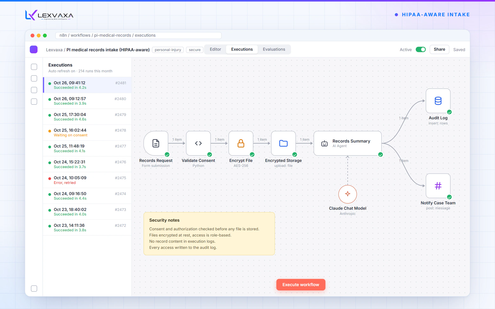

<!-- styled:v2 -->

**A secure intake system for personal injury firms that checks consent, encrypts medical records, writes an AI summary and logs every access.**

  
  
  
  
  
  
  
  

  <a href="#overview">Overview</a> ·
  <a href="#key-features">Key features</a> ·
  <a href="#results">Results</a> ·
  <a href="#tech-stack">Tech stack</a>

---

## Overview

Personal injury cases depend on medical records, which must be collected and handled with strict privacy. Lexvaxa built a secure records intake app in Python with HIPAA requirements in mind, orchestrated with n8n. A secure form checks consent and authorization before any file is stored, records are encrypted with restricted access, an AI model summarises treatment, providers and dates for the case team, and every access is written to an audit log. Screens shown use sample data, so no client records are exposed.

## The challenge

Medical records arrived by email and fax, were hard to track and had to be handled under strict privacy rules.

## The solution

A Python and n8n workflow: consent validation, AES-256 encryption, encrypted storage, an AI records summary, role-based access, audit logging and a case team alert.

## Key features

- Secure intake form with consent and authorization check
- Files encrypted at rest with AES-256
- Role-based access to case files
- AI summary of treatment, providers and dates
- Full audit log of every access
- No record content in execution logs
- Case team notified when records are ready

## Results

- Medical records are collected safely and ready for case review sooner

## Tech stack

      

## Demo

A working version of the dashboard UI with **sample data** is in [`demo/index.html`](demo/index.html). Download it and open it in a browser; it has no build step.

## Privacy

Client names and records are confidential. Every screen in this repository uses sample data, and source code that belongs to the client is not published.

## Links

- Case study on Lexvaxa: https://lexvaxa.com/work/pi-medical-records-intake

---

**Built by [Ch Muhammad Samiullah](https://github.com/samiullah156-creator)** · AI Automation Engineer and Full-Stack Developer at [Lexvaxa](https://lexvaxa.com)

⭐ Star this repo if you found it useful

